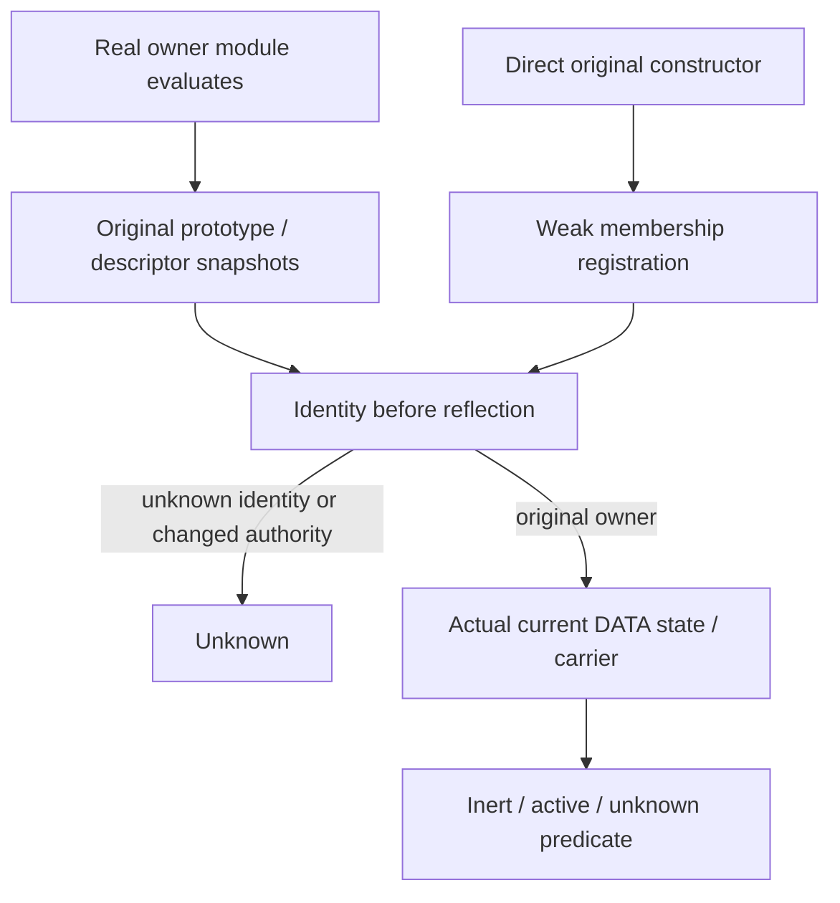

# Private read authority

This folder observes existing owner state without invoking user code. It does not track reads or produce recorder paths.

| Owner               | Responsibility                                                                                                 |
| ------------------- | -------------------------------------------------------------------------------------------------------------- |
| `identity`          | Data-only weak identity, original prototype/descriptor snapshots and separate registration/admission functions |
| `owners`            | Fixed Rule/context method vocabularies; snapshots created at original owner-module evaluation                  |
| `intrinsics`        | Captured descriptor operations and brand-first native Set cardinality                                          |
| `rule`              | Complete current marked/policy/inherited predicate; inert, active or unknown                                   |
| `policy`            | Only native frozen policy creation sites mint carrier identity; no observation callbacks                       |
| `policyObservation` | Current admitted carrier predicate, separated from constructor/mint dependencies                               |
| `context`           | Read the actual current DATA policy carrier, including replacement; never a cached Rule                        |

Constructor registration retains owner DATA, not observation closures. Constructor/method function identities inside the descriptor snapshots are required data, not forbidden callbacks. Context links Rule/policy observations only when observation is actually requested; descriptor and Set-getter capture remain eager at their original module-evaluation sites. There is no lazy first-construction/first-observation snapshot or purity annotation.

Only the `memory/readAuthority.ts` facade and this folder import these modules. Original constructors register weakly, without adding fields or changing public method behavior. Unknown identities are refused before reflection. Set branding precedes prototype/descriptor inspection so a Proxy receives no trap. Custom methods, accessors, subclasses, shadows and changed original descriptors are unknown.

An optional policy `redaction` slot is absent only when its admitted native prototype chain has no such descriptor either. Inherited data or accessor authority is unknown without executing it; explicit own `undefined` still shadows inheritance. Required Rule/context DATA slots already treat missing descriptors as unknown. The Set's absent own `size` is resolved only against the checked original native getter.

`rule.test.mjs` and `context.test.mjs` exercise real owners, shared marks, current-carrier replacement, callback/trap refusal and unchanged borrowed value behavior. Metadata can observe current inert state after unseen shared Set mutations clear; this is no interval certificate. There is no epoch, mirrored policy, live A/B/C sampling, call-local read holder, native paired read or recorder event change. The later event-time adapter and its public path/dependency adoption require their own source scope and proof.

Existing `redaction.ts` and `StageContext.ts` remain oversized owners; only whole constant units are extracted in this phase to keep their ratchets shrinking. This is not a completed class split. Packed CJS/ESM, public/runtime-key parity, full hosted gates and unchanged bundle budgets remain required for this private foundation.

`keys.test.mjs` uses `test/fixtures/read-authority-parent-keys.json`, captured from exact Main ab021ccb65e73426a22fee5e0183b3886a588197 with the three runtime owners restored byte-for-byte before source capture. Parent and candidate public/default controls pass separately. The fixture pins actual public exports and Rule/context/facade own/prototype keys, not a new API or raised baseline. `test/architecture/read-authority-package.test.ts` packs the real built package on hosted CI and repeats those checks in fresh CJS/ESM processes, reusing the existing locked physical Foottrace. This does not prove a new native API, strict future-version pair or event-time integration. Its disposable package/cache/extraction are removed in `finally`.

`owners.test.mjs` checks data-only registration while preserving method identities and uses fresh actual source-module processes for mutations before first construction/observation. `policyObservation.test.mjs` checks native carrier membership and Proxy refusal. The bounded architecture source-graph guard checks fixed-value consumers and constructor-only imports; its result is not an emitted-package size acceptance. Every existing bundle cap remains unchanged.
